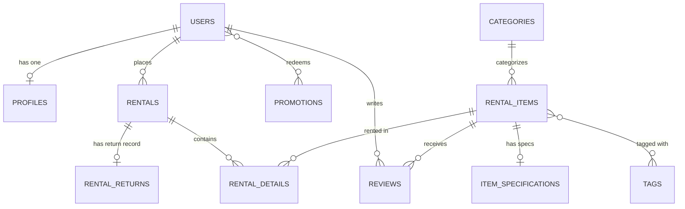

# RentHub — Equipment & Vehicle Rental System

RentHub adalah aplikasi web rental kendaraan dan peralatan berbasis **Laravel**, **Blade**, dan **Tailwind CSS**. Proyek ini dikembangkan untuk tugas mata kuliah *Pemrograman Berorientasi Objek 2 (PBO 2)* dengan fokus utama pada perancangan basis data dan implementasi **relasi antar tabel** menggunakan Eloquent ORM.

## Informasi Mahasiswa

| Identitas | Keterangan |
|---|---|
| **Nama** | Wira Yudha Pamuji |
| **NPM** | 2410010396 |
| **Kelas** | TI 5D REG BJB |
| **Mata Kuliah** | Pemrograman Berorientasi Objek 2 (PBO 2) |
| **Dosen Pengampu** | Mirza Yogy Kurniawan |
| **Fase / Tugas** | P01: Database Design and Table Relationships (Assignment 1) |

---

## Fitur Utama

- **Katalog Sewa Multi-Kategori**: Mobil, Sepeda Motor, Kamera & Fotografi, Alat Camping & Outdoor, Sound System & Audio, dan Alat Konstruksi & Pertukangan.
- **Spesifikasi Detail Unit**: Rincian nomor polisi/seri, tahun pembuatan, warna, catatan kondisi, dan spesifikasi teknis dalam format JSON.
- **Sistem Transaksi Sewa (Rentals)**: Manajemen durasi sewa, kalkulasi biaya harian, dan pencatatan kondisi barang sebelum sewa.
- **Pengembalian & Denda (Rental Returns)**: Verifikasi kondisi barang pasca-sewa, kalkulasi keterlambatan (hari), dan denda penalti.
- **Tag Fleksibel**: Pengelompokan barang berdasarkan tag (Best Seller, Premium, Outdoor, Hemat, Portable, New Arrival).
- **Kupon Promosi (Promotions)**: Penggunaan kupon diskon dengan pencatatan riwayat pemakaian dan nominal potongan.
- **Ulasan & Rating (Reviews)**: Ulasan pelanggan (skala bintang 1–5) terhadap unit barang sewa.

---

## Perancangan Basis Data (ERD)

Dokumentasi rancangan skema basis data lengkap tersedia di [`docs/database/erd.md`](docs/database/erd.md).



### Relasi Eloquent yang Diimplementasikan

| Tipe Relasi | Pasangan Model | Metode Eloquent | Deskripsi |
|---|---|---|---|
| **One-to-One** | `User` ↔ `Profile` | `hasOne` / `belongsTo` | Setiap pengguna memiliki satu profil biodata |
| **One-to-One** | `RentalItem` ↔ `ItemSpecification` | `hasOne` / `belongsTo` | Setiap barang memiliki satu catatan spesifikasi teknis |
| **One-to-One** | `Rental` ↔ `RentalReturn` | `hasOne` / `belongsTo` | Setiap transaksi sewa memiliki satu catatan pengembalian |
| **One-to-Many** | `Category` → `RentalItem` | `hasMany` / `belongsTo` | Satu kategori menaungi banyak barang sewa |
| **One-to-Many** | `User` → `Rental` | `hasMany` / `belongsTo` | Satu pengguna memiliki banyak transaksi sewa |
| **One-to-Many** | `User` → `Review` | `hasMany` / `belongsTo` | Satu pengguna dapat menulis banyak ulasan |
| **One-to-Many** | `RentalItem` → `Review` | `hasMany` / `belongsTo` | Satu barang sewa dapat menerima banyak ulasan |
| **One-to-Many** | `Rental` → `RentalDetail` | `hasMany` / `belongsTo` | Satu sewa terdiri dari banyak baris detail barang |
| **One-to-Many** | `RentalItem` → `RentalDetail` | `hasMany` / `belongsTo` | Satu barang tercatat di banyak detail transaksi |
| **Many-to-Many** | `RentalItem` ↔ `Tag` | `belongsToMany` | Relasi tag produk melalui tabel pivot `item_tag` |
| **Many-to-Many (Pivot Data)** | `Rental` ↔ `RentalItem` | `belongsToMany` + `withPivot` | Detail item sewa: `quantity`, `price_per_day`, `subtotal`, `condition_before` |
| **Many-to-Many (Pivot Data)** | `User` ↔ `Promotion` | `belongsToMany` + `withPivot` | Penggunaan kupon diskon: `used_at`, `discount_amount` |
| **Has-Many-Through** | `User` → `RentalDetail` | `hasManyThrough` | Mengakses seluruh detail barang sewa milik pengguna melalui transaksi |
| **Has-Many-Through** | `Category` → `RentalDetail` | `hasManyThrough` | Mengakses riwayat peminjaman per kategori melalui barang |
| **Has-Many-Through** | `Category` → `Review` | `hasManyThrough` | Mengakses seluruh ulasan dalam kategori melalui barang |

---

## Memulai Proyek

```bash
# 1. Clone repository dari fork
git clone https://github.com/wirayudhapamuji123/laravel5d.git
cd laravel5d

# 2. Pindah ke branch fitur
git switch feature/database-relations

# 3. Pasang dependensi
composer install
npm install

# 4. Konfigurasi file environment
copy .env.example .env
php artisan key:generate

# 5. Jalankan migrasi dan seeder
php artisan migrate:fresh --seed

# 6. Jalankan pengujian relasi otomatis
php artisan test

# 7. Jalankan server lokal
php artisan serve
```

---

## Verifikasi dan Pengujian

Seluruh relasi telah diuji secara otomatis menggunakan PHPUnit / Pest test suite pada file [`tests/Feature/DatabaseRelationsTest.php`](tests/Feature/DatabaseRelationsTest.php):

```bash
php artisan test --testsuite=Feature
```

**Hasil pengujian:** 14 passed tests, 50 assertions, 100% lulus.

---

## Panduan Fork & Alur Kerja Git

Panduan langkah demi langkah cara fork, branch, dan membuat pull request (PR) ke repository dosen tersedia di:
[`docs/guides/fork-guide.md`](docs/guides/fork-guide.md).

Laporan progres pekerjaan fase `P01` tersedia di:
[`docs/progress/P01-database-design.md`](docs/progress/P01-database-design.md).

---

## Struktur Folder

```
app/Models/              # Model Eloquent dan definisi relasi
database/
  migrations/            # Definisi skema tabel & constraint
  factories/             # Generator data uji untuk setiap model
  seeders/               # Seeder kategori dan data sampel RentHub
tests/
  Feature/               # Pengujian otomatis relasi basis data
docs/
  database/              # ERD dan dokumentasi relasi basis data
  guides/                # Panduan alur Git dan Fork repository dosen
  progress/              # Pelacak kemajuan fase dan job (P01)
```

---

## Lisensi

Dirilis di bawah [MIT License](https://opensource.org/licenses/MIT).
