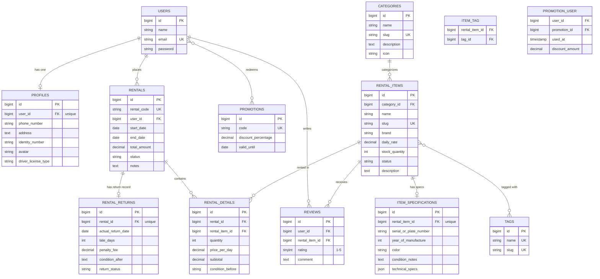

# Database Design — Entity Relationship Diagram

This document describes the database schema of **RentHub** (Equipment & Vehicle Rental System) and every Eloquent relationship used in the project.

## 1. Entity Relationship Diagram

## 2. Relationship Summary

| Type | Relationship | Eloquent Methods | Description |
|---|---|---|---|
| **One-to-One** | `User` ↔ `Profile` | `hasOne` / `belongsTo` | Setiap pengguna memiliki satu profil biodata lengkap |
| **One-to-One** | `RentalItem` ↔ `ItemSpecification` | `hasOne` / `belongsTo` | Setiap unit item sewa memiliki satu rincian spesifikasi teknis |
| **One-to-One** | `Rental` ↔ `RentalReturn` | `hasOne` / `belongsTo` | Setiap transaksi sewa memiliki satu catatan pengembalian unit |
| **One-to-Many** | `Category` → `RentalItem` | `hasMany` / `belongsTo` | Satu kategori menaungi banyak barang/kendaraan sewa |
| **One-to-Many** | `User` → `Rental` | `hasMany` / `belongsTo` | Satu pengguna dapat melakukan banyak transaksi sewa |
| **One-to-Many** | `User` → `Review` | `hasMany` / `belongsTo` | Satu pengguna dapat memberikan banyak ulasan barang |
| **One-to-Many** | `RentalItem` → `Review` | `hasMany` / `belongsTo` | Satu barang sewa dapat menerima banyak ulasan dari penyewa |
| **One-to-Many** | `Rental` → `RentalDetail` | `hasMany` / `belongsTo` | Satu transaksi sewa terdiri dari banyak baris detail item |
| **One-to-Many** | `RentalItem` → `RentalDetail` | `hasMany` / `belongsTo` | Satu barang sewa dapat tercatat di banyak detail transaksi sewa |
| **Many-to-Many** | `RentalItem` ↔ `Tag` | `belongsToMany` | Hubungan barang sewa dengan tag fleksibel (pivot `item_tag`) |
| **Many-to-Many (Pivot Data)** | `Rental` ↔ `RentalItem` | `belongsToMany` + `withPivot` | Relasi item transaksi sewa dengan atribut `quantity`, `price_per_day`, `subtotal`, `condition_before` |
| **Many-to-Many (Pivot Data)** | `User` ↔ `Promotion` | `belongsToMany` + `withPivot` | Kupon promosi yang diklaim pengguna dengan atribut `used_at`, `discount_amount` |
| **Has-Many-Through** | `User` → `RentalDetail` (via `Rental`) | `hasManyThrough` | Mengakses seluruh detail barang yang pernah disewa pengguna |
| **Has-Many-Through** | `Category` → `RentalDetail` (via `RentalItem`) | `hasManyThrough` | Mengakses seluruh transaksi detail peminjaman per kategori |
| **Has-Many-Through** | `Category` → `Review` (via `RentalItem`) | `hasManyThrough` | Mengakses seluruh ulasan barang di bawah suatu kategori |

## 3. Seeded Categories

Tabel `categories` diisi dengan kategori rental populer:

1. **Mobil (Cars)** (`mobil`): City car, SUV, MPV keluarga.
2. **Sepeda Motor (Motorcycles)** (`sepeda-motor`): Matic, sport, trail adventure.
3. **Kamera & Fotografi (Cameras & Photography)** (`kamera-fotografi`): Mirrorless, DSLR, lensa, lighting.
4. **Alat Camping & Outdoor (Outdoor Gear)** (`alat-camping-outdoor`): Tenda dome, nesting, sleeping bag, carrier.
5. **Sound System & Audio (Audio Equipment)** (`sound-system-audio`): Speaker portable, wireless mic, mixer audio.
6. **Alat Konstruksi & Pertukangan (Power Tools)** (`alat-konstruksi`): Bor baterai, mesin gerinda, genset.

## 4. Design Integrity & Constraints

- **Foreign Keys & Cascades:** Penghapusan user menghapus profil, transaksi, dan riwayat promosi. Penghapusan kategori dibatasi (`restrictOnDelete`) jika masih memiliki unit rental aktif.
- **Unique Constraints:** `users.email`, `profiles.user_id`, `categories.slug`, `rental_items.slug`, `item_specifications.rental_item_id`, `tags.slug`, `rentals.rental_code`, `rental_returns.rental_id`, dan `promotions.code`.
- **Integrity Validation:** Relasi pivot `rental_details` dan `item_tag` menggunakan foreign key terindeks untuk optimasi query.
